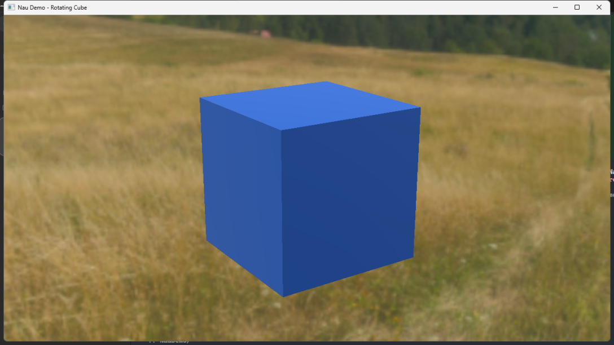

# Nau Demo: Rotating Cube

## Toolchain and migration

NauDemo consumes the engine's C++20 toolchain-standard-library interfaces. The
migration is source/ABI breaking: rebuild the engine, shared sample support, and
NauDemo together in fresh Debug and Release build directories. Do not reuse a
pre-migration CMake cache or link this demo against old engine binaries. EASTL
and EABase are not required demo dependencies. Native and browser commands,
toolchain pins, and coordinated rebuild guidance are in the repository
[build guide](../build.md) and [prerequisites](../prerequisites.md).

## Browser build

The separate web profile runs the real rotating cube with a simplified blue
material in Chrome. On Windows, from `NauDemo/` run `run_web.bat` for Debug or
`run_web.bat Release` for Release. It activates SDK 6.0.9 if installed under
`%USERPROFILE%\emsdk`, builds the package, starts the local server, and opens
the browser. Press Ctrl+C to stop serving; answer Y if CMD prompts you.

For the manual steps, from `NauEngineLite/` after activating SDK 6.0.9:

```powershell
. "$HOME/emsdk/emsdk_env.ps1"
../NauDemo/web/build.ps1 -Configuration Debug
../NauDemo/web/build.ps1 -Configuration Release
python build/web-demo-debug/package/serve.py --port 8000
```

Open the printed URL. Stop waits for cleanup; reload to retry. Copy the entire
package to serve elsewhere. Browser updates follow the presentation callback;
rotation uses elapsed time rather than a fixed 100 ms step. See the
[complete browser guide](doc/naudemo_web.md) for prerequisites,
package inventory, tests, failure behavior and the fresh-checkout walkthrough.

## Native application

A native Nau Engine application showing a lit blue cube rotating around the
vertical **Y axis** at **45 degrees per second** (one revolution every eight
seconds). A fixed perspective camera and the engine's sample environment provide
a clear view of the motion. Close the window to exit.



## Run

The Debug executable has been built in this checkout. From PowerShell:

```powershell
./run.ps1
```

You can also launch `bin/Debug/NauDemo.exe` directly. Keep this folder and the
sibling `NauEngineLite` checkout in place: the executable uses their asset paths.
Rebuild after relocating either folder. Windows x64 and a DirectX 12 capable GPU
are required.

## Rebuild using the existing engine libraries

Requires Python, Visual Studio with MSVC v145, and a successfully built static
`SceneBaseSample` in `../NauEngineLite/build/win_vs2026_x64`.

```powershell
python ./build.py
./run.ps1
```

`build.py` reads the engine-generated `SceneBaseSample.vcxproj` to reuse its exact
include paths, compiler settings, static module registration, and transitive
libraries. It writes a separate project under `NauDemo/build/`, compiles the demo,
and copies runtime DLLs to `NauDemo/bin/Debug/`. It does not modify the engine
project or rebuild its libraries. This also handles the relocated engine build
cache present in this workspace. After engine source changes, rebuild the engine
first to keep its libraries and headers consistent.

For another engine build location or configuration:

```powershell
python ./build.py --engine ../NauEngineLite --engine-build ../NauEngineLite/build/win_vs2026_x64 --config Release
./run.ps1 -Configuration Release
```

The matching engine libraries must already exist. This fast build supports the
static Visual Studio preset; it deliberately rejects DLL builds.

## Build from engine sources with CMake

For a fresh checkout, follow the prerequisites in [the repository build guide](../build.md).
The supplied CMake hook adds the demo after the engine targets are defined,
using the engine's optional `NAU_DEMO_SOURCE_DIR` integration. From `NauDemo/`, in a configured development
shell with `VCPKG_ROOT`, Python, `cymbal`, and `clang` available:

```powershell
$demoPath = (Get-Location).Path.Replace('\', '/')
Push-Location ../NauEngineLite
cmake --preset win_vs2026_x64 -B "$demoPath/build/engine" "-DCMAKE_PROJECT_NauEngine_INCLUDE=$demoPath/cmake/attach_demo.cmake"
cmake --build "$demoPath/build/engine" --config Debug --target NauDemo
Pop-Location
./run.ps1
```

This builds the engine and `SceneBaseSample` dependencies, including shared shader
caches. The executable is still written to `NauDemo/bin/Debug/`, and runtime DLLs
are copied there automatically. Both configurations have passed native visual acceptance
with the external NauSamples integration.

## Files and customization

- `src/main.cpp`: native application, material, light and environment setup.
- `src/demo_scene.h`: shared cube/camera construction and elapsed-time rotation.
  Change `radiansPerSecond` to adjust rotation speed or direction.
- `assets/cube.gltf` and `cube.bin`: a centered 2 × 2 × 2 cube with six hard-edged
  faces, normals, UVs, and tangents; no external modeling tool is needed.
- `assets/cube.nmat_json`: blue material using Nau's standard shader pipelines.
- `config/app.json`: mounts demo assets and the engine's sample shaders/textures.
- `build.py`, `CMakeLists.txt`, and `cmake/attach_demo.cmake`: the two build routes.

Logs are written to `%LOCALAPPDATA%/nau/NauDemo/logs/`. The engine's Debug renderer
currently emits DirectX 12 resource-initialization validation messages during
environment processing; these were observed during the visual check. If assets
are missing, verify the sibling engine checkout and its compiled
`../NauSamples/sceneBase/resources/shaders/cache/shader_cache.nsbc` before launching.

The material and application setup follow Nau's sample implementation. Nau's
license is retained in `NAU-LICENSE.txt`; engine assets and third-party components
retain their upstream licenses.
